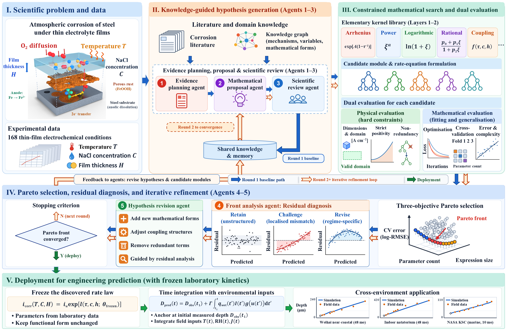

# KGED: Knowledge-guided Equation Discovery for Atmospheric Steel Corrosion

Engineering test data and code accompanying the manuscript:

> **Knowledge-guided discovery of explicit thin-film kinetic laws for engineering prediction of atmospheric steel corrosion**

**Authors:** Kunyao Li<sup>a,†</sup>, Huajie Wang<sup>b,†</sup>, Hongliang Qian<sup>b</sup>, Minling Wang<sup>b</sup>, Feng Qiu<sup>c,&#42;</sup>, Haijiang Li<sup>a,&#42;</sup>

<sup>a</sup> School of Engineering, Cardiff University, Queen's Buildings, The Parade, Cardiff CF24 3AA, UK<br>
<sup>b</sup> Department of Civil Engineering, Harbin Institute of Technology at Weihai, 264209 Weihai, Shandong, China<br>
<sup>c</sup> State Key Laboratory of Deep Earth Exploration and Imaging, College of Construction Engineering, Jilin University, Changchun 130026, China<br>
<sup>†</sup> These authors contributed equally to this work. <sup>&#42;</sup> Corresponding authors: `qiu_feng@jlu.edu.cn` (F. Qiu), `lih@cardiff.ac.uk` (H. Li).



*Fig. 1. Overview of the five-stage Knowledge-guided Equation Discovery (KGED) workflow.*

## Quick Start: Engineering Corrosion Prediction

All four field-exposure test datasets (`engineering/inputs/`: Weihai shoreline source site and Weihai near-coastal, indoor natatorium, and NASA KSC target sites) and frozen rate-law coefficients are bundled directly in this repository. Requires **Python 3.9+** (`numpy`, `scipy`, `matplotlib`, and `sympy`).

```bash
python -m pip install -r requirements.txt
python run_engineering_predictions.py
```

Windows users can also double-click `run_engineering_predictions.bat`. All reproduced tables (`Table 7`, `Fig. 10` benchmark comparisons, parameter provenance), trajectory predictions, rate-law ablation results, and 300 DPI figures (`Figs. 9–11`, `Figs. S3–S5`) are written to `engineering/results/` (exact package versions used for verification are listed in `requirements-lock.txt`).

> **Station file prefixes** follow `Table 1` of the manuscript:
> - `linhai_*` → **Weihai shoreline** (source calibration site; HIT-Weihai Radar Station, 50 m from shoreline)
> - `jinhai_*` → **Weihai near-coastal** (target site; HIT-Weihai Hillside Outdoor Exposure Station, 1000 m inland)
> - `pool_*` → **Indoor natatorium** (target site; Weihai Sports School enclosed chlorinated natatorium)
> - `ksc_*` → **NASA KSC** (target site; Beachside Corrosion Test Site, Kennedy Space Center, FL, USA)

## Verification Tests

Verify the cross-environment engineering corrosion-depth predictions directly:

```bash
python tests/test_engineering_prediction.py
```

Or run the full offline verification suite:

```bash
python -m unittest discover -s tests -v
```

## Two-Layer Knowledge Graph & Corpus Assets

- **50-paper literature corpus & coverage analysis (`literature/`)**: Bibliographic inventory `C01`–`C50` (`WOS_Golden_Corpus_Top50.csv`), 302 extracted relationships (`extracted_formulas_302.json`), semantic tags (`semantic_classification/`), and 9-category literature model-form coverage analysis (`saturation_audit/`, `Fig. S1`).
- **Layer 1 — Literature layer (`knowledge_graph/literature_graph/`)**: Provenance graph (`graph.graphml`, `report.json`, `stability_table.csv`, `top_symbols.csv`; 1,057 nodes and 3,116 edges across 50 papers) linking corrosion mechanisms, environmental variables, and published expressions to hypotheses `H1`–`H4`.
- **Layer 2 — Mathematical-family layer (`knowledge_graph/math_graph.json`)**: 8 canonical mathematical families, 12 fine-grained process tags, and construction rules built by `knowledge_graph/build_math_knowledge.py`; together, Layer 1 literature-derived kernels and Layer 2 family-completion kernels form the 31 dimensionless elementary kernels (`K01`–`K31`).
- **Round-wise candidate modules (`knowledge_graph/modules_M01_M41_4round.csv` / `.json`)**: Inventory of all 41 dimensionless modules across Stages II–IV (`M01`–`M20` in the Round 1 baseline pool from Layer 1; `M21`–`M41` in Rounds 2–4 via residual-guided expansion across Layers 1–2) and deterministic template-compilation, pre-optimisation screening, 23-fold grouped-CV scoring, 1-SE selection, and Eq. (8) convergence scripts (`knowledge_graph/maief/`).

## License

Code is released under the [MIT License](LICENSE); field-exposure test datasets, curated knowledge-graph assets, and model archives are shared under CC BY 4.0 (see `LICENSE` for details).
